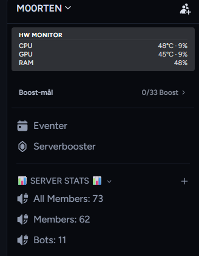

# 🖥️ Hardware Monitor Overlay

**Live CPU, GPU and RAM stats right inside your Discord sidebar.**

---

## ✨ Features

- 🌡️ **CPU** temperature and load
- 🎮 **GPU** temperature and load (automatically prefers your dedicated GPU over integrated graphics)
- 🧠 **RAM** usage
- 📍 Shows in **DMs** (below *Message Requests*) and in **servers** (below the server name)
- 🎨 Follows your Discord theme colors
- ⚡ Lightweight – one request every 2 seconds, no background services of its own
- 🔍 Hover a row to see the exact hardware name

## 📋 Requirements

| Requirement | Notes |
|---|---|
| Windows | LibreHardwareMonitor is Windows-only |
| [BetterDiscord](https://betterdiscord.app) | Installed on your Discord client |
| [LibreHardwareMonitor](https://github.com/LibreHardwareMonitor/LibreHardwareMonitor) | Must be running, with the remote web server enabled |

## 🚀 Installation

### 1. Set up LibreHardwareMonitor

1. Download and start LibreHardwareMonitor (run as administrator for full sensor access).
2. Go to **Options → Remote Web Server → Run**.
3. Check that `http://localhost:8085/data.json` opens in your browser.

### 2. Install the plugin

1. Download [`HardwareMonitorOverlay.plugin.js`](HardwareMonitorOverlay.plugin.js).
2. Open Discord → **Settings → Plugins → Open Plugins Folder**.
3. Move the file into that folder.
4. Enable **HardwareMonitorOverlay** in the plugin list.

## ⚙️ Configuration

Open the plugin file in a text editor and change the constants at the top:

| Constant | Default | Description |
|---|---|---|
| `DATA_URL` | `http://localhost:8085/data.json` | LibreHardwareMonitor endpoint. Change this to monitor another machine on your network. |
| `UPDATE_MS` | `2000` | Refresh interval in milliseconds. |
| `RAM_OFFSET` | `-10` | RAM calibration in percentage points (see below). |

### Calibrating RAM

LibreHardwareMonitor and Windows Task Manager calculate RAM usage slightly differently,
so the numbers may not match. Compare the overlay with Task Manager and adjust `RAM_OFFSET`
until they line up. Set it to `0` for the raw LibreHardwareMonitor value.

## 🛠️ Troubleshooting

<b>It says "Ingen data" / "No data"</b>

LibreHardwareMonitor is not running, or the Remote Web Server is turned off.
Open `http://localhost:8085/data.json` in your browser – if it doesn't load, the plugin can't either.

<b>Temperatures are missing</b>

Run LibreHardwareMonitor as administrator. Without it, many CPU/GPU sensors are not available.

<b>The wrong GPU is shown</b>

The plugin picks the GPU with the most sensors and penalizes integrated graphics.
If it still picks wrong, [open an issue](../../issues) and include your hardware names.

<b>The overlay doesn't appear</b>

Discord updates can change the sidebar layout. Try toggling the plugin off and on, or
reload Discord with `Ctrl + R`. If it still doesn't show, [open an issue](../../issues).

## 🔒 Privacy

The plugin only talks to the address in `DATA_URL` (your own LibreHardwareMonitor by default).
No data is sent anywhere else.

## 🤝 Contributing

Bug reports and pull requests are welcome. Please include your Discord/BetterDiscord
version and LibreHardwareMonitor version when reporting problems.

## 📄 License

Released under the [MIT License](LICENSE).

---

Made by <b>M00RTEN</b> · <a href="https://discord.gg/gBctYMD3fd">Discord</a>

